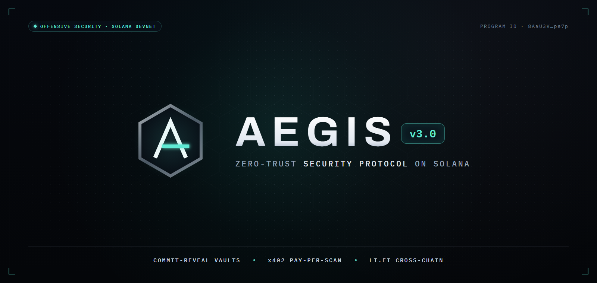
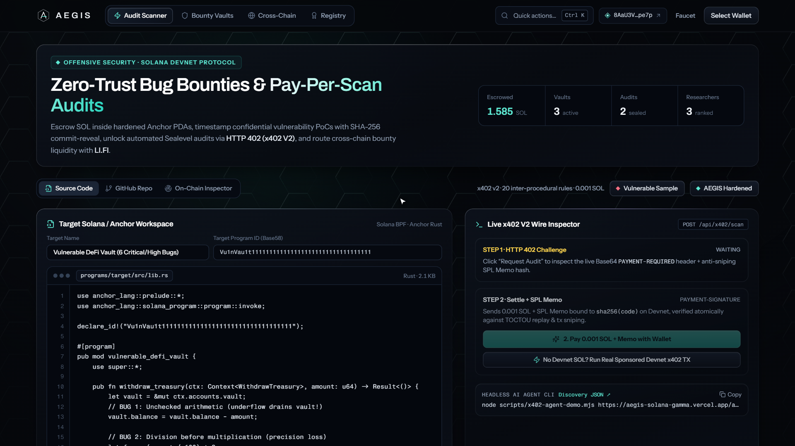
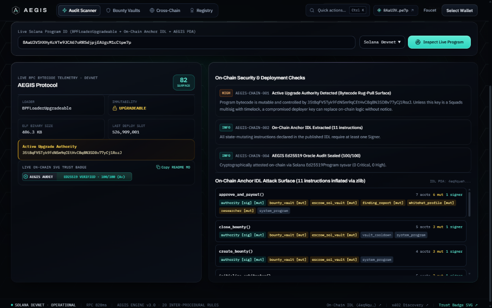
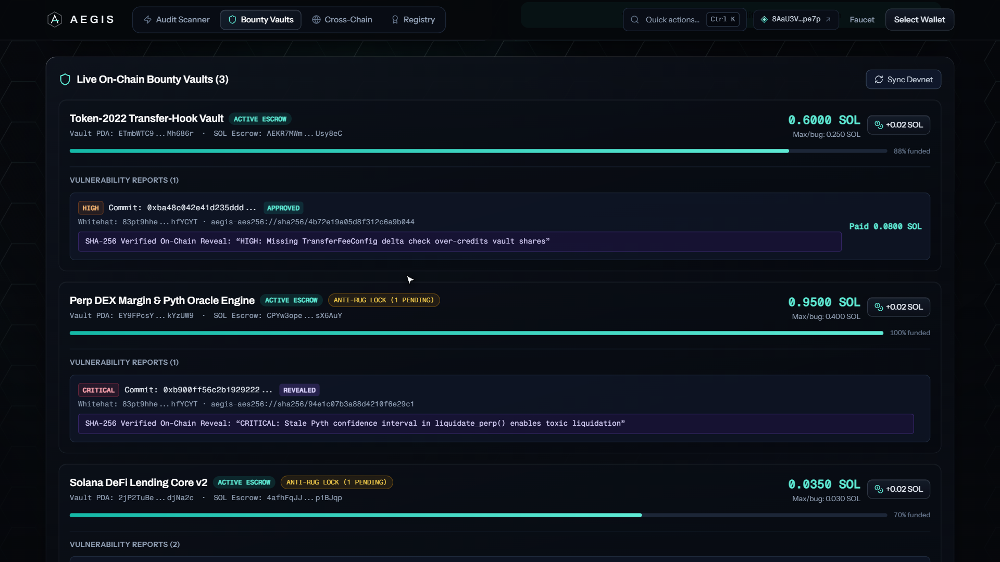
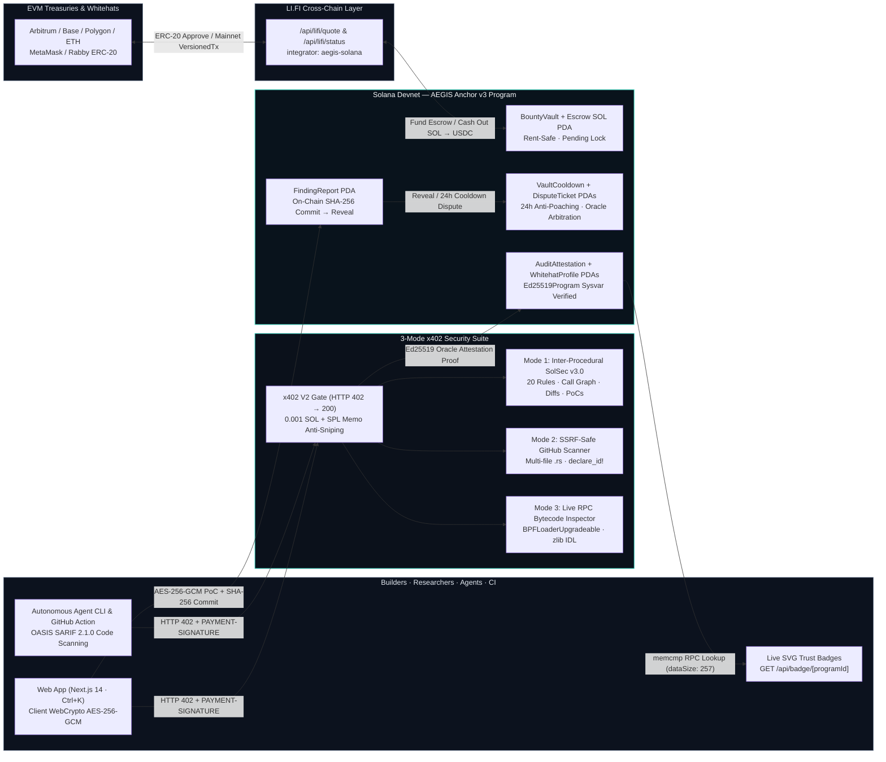

<div align="center">



<br />

<h3>Zero-Trust Bug Bounty Vaults, 3-Mode x402 Security Suite &amp; LI.FI Cross-Chain Router on Solana</h3>

<p>
  <strong>Dev3pack Global Solana Hackathon — Chile Hub 🇨🇱</strong><br />
  Architected &amp; built by an Ethical Hacker / Pentester for the Solana ecosystem.
</p>

<p>
  <a href="https://aegis-solana-gamma.vercel.app">
    
  </a>
  <a href="https://explorer.solana.com/address/8AaU3VSHXHyKcVTe9JCA67oRR5djpjfAUgcM1cCtpe7p?cluster=devnet">
    
  </a>
  <a href="#solana-rust--anchor-v3-smart-contract-1717-tests-passing">
    
  </a>
  <a href="#2-x402-v2-pay-per-scan--ed25519-oracle--sarif-210">
    
  </a>
  <a href="#4-lifi-cross-chain-treasury--whitehat-payout-router">
    
  </a>
  <a href="LICENSE">
    
  </a>
</p>

<p>
  <a href="https://explorer.solana.com/address/8AaU3VSHXHyKcVTe9JCA67oRR5djpjfAUgcM1cCtpe7p?cluster=devnet">
    
  </a>
</p>

<p>
  <a href="#30-second-judge-verification"><strong>Judge Verification</strong></a> ·
  <a href="#live-interface-showcase"><strong>UI Showcase</strong></a> ·
  <a href="#system-architecture"><strong>Architecture</strong></a> ·
  <a href="#live-verified-solana-devnet-proof"><strong>Devnet Proof</strong></a> ·
  <a href="#solana-rust--anchor-v3-smart-contract-1717-tests-passing"><strong>Anchor v3 Contract</strong></a> ·
  <a href="#quickstart--local-development"><strong>Quickstart</strong></a>
</p>

</div>

<p align="center">
  
</p>

## 30-Second Judge Verification

> [!TIP]
> **Zero-Wallet Live Devnet Testing Included:** Judges without Phantom or Devnet SOL can click **`No Devnet SOL? Run Real Sponsored Devnet x402 TX`** in the **Audit Scanner** tab to execute a genuine on-chain `0.001 SOL + SPL Memo` Devnet payment, `HTTP 402 → 200 OK` handshake, Inter-Procedural Call-Graph audit, and `Ed25519` Oracle Attestation Proof in one click.

| Artifact | Value / Verification Link |
| :--- | :--- |
| **Live Production Web App (Vercel)** | [**https://aegis-solana-gamma.vercel.app**](https://aegis-solana-gamma.vercel.app) |
| **Solana Devnet Program ID (v3.0)** | [`8AaU3VSHXHyKcVTe9JCA67oRR5djpjfAUgcM1cCtpe7p`](https://explorer.solana.com/address/8AaU3VSHXHyKcVTe9JCA67oRR5djpjfAUgcM1cCtpe7p?cluster=devnet) |
| **On-Chain Compressed Anchor IDL (`anchor:idl`)** | [`4eqNqueh9JDD7j614TynsRPCtXSBRvzCs4XVdHXbjNa9`](https://explorer.solana.com/address/4eqNqueh9JDD7j614TynsRPCtXSBRvzCs4XVdHXbjNa9?cluster=devnet) (`zlib` inflated live in UI) |
| **Arbitration Config PDA (`arb_config`)** | [`9mEvVeuQMn1zvgrRX1D3o7DoHswA94eXj28pahme8XeM`](https://explorer.solana.com/address/9mEvVeuQMn1zvgrRX1D3o7DoHswA94eXj28pahme8XeM?cluster=devnet) |
| **Tracked Compiled Anchor IDL** | [`idl/aegis402.json`](idl/aegis402.json) *(inspect all 11 instructions without building Rust)* |
| **Anchor Integration & Game-Theory Tests** | [`tests/aegis402.ts`](tests/aegis402.ts) — **`17 / 17` passing** |
| **Keyboard Quick Actions** | Press **`Ctrl + K`** (`⌘ + K`) anywhere in the web app to jump to Devnet / Mainnet program presets |

**Headless Autonomous AI Agent CLI & SARIF 2.1.0 CI Gate:**

```bash
node scripts/x402-agent-demo.mjs https://aegis-solana-gamma.vercel.app/api/x402/scan \
  --target programs/aegis402/src/lib.rs \
  --sarif aegis-report.sarif \
  --fail-on-critical
```

<p align="center">
  
</p>

## Live Interface Showcase

### 1. Audit Scanner — Precision IDE & Live x402 V2 Wire Inspector
> Multi-file `.rs` IDE frame with scroll-synced line gutters, click-to-jump finding diagnostics, 20 inter-procedural Sealevel/Token-2022/Oracle rules, interactive Call Graph, visual Patch Diffs, Anchor TS Exploit PoCs, and live `HTTP 402 → SPL Memo → Ed25519` inspection.

<p align="center">
  
</p>

### 2. Live On-Chain Solana Program Inspector (`BPFLoaderUpgradeable` + `zlib` Anchor IDL)
> Inspects any live **Solana Devnet** or **Mainnet** Program ID (e.g., AEGIS v3 Devnet, Jupiter v6 Mainnet, Token-2022): extracts upgrade authority risk, ELF `.so` size, last deployed slot, decompresses on-chain Anchor IDLs via `zlib`, and serves live `memcmp`-verified SVG Trust Badges.

<p align="center">
  
</p>

### 3. Zero-Trust Bounty Vaults — Client `AES-256-GCM` & On-Chain SHA-256 Commit-Reveal
> Rent-safe Anchor PDA escrow vaults with anti-rug-pull `pending_findings` lock, client-side WebCrypto `AES-256-GCM` PoC encryption, on-chain SHA-256 preimage verification, **24-hour anti-poaching `VaultCooldown`**, and `Ed25519` Oracle Dispute Arbitration.

<p align="center">
  
</p>

<p align="center">
  
</p>

## The Problem

Web3 security suffers from three broken primitives:

1. **Finding Front-Running & Post-Disclosure PoC Poaching:** When an ethical hacker reports a critical vulnerability over email or Discord, malicious protocols can silently patch the bug, reject the report, and drain the bounty pool—leaving the researcher with zero cryptographic proof or recourse.
2. **Inaccessible Smart Contract Audits:** Early-stage Solana builders cannot afford $50K+ audits before shipping, yet will gladly pay micro-payments (**0.001 SOL / scan**) for instant inter-procedural Sealevel, Token-2022, Oracle, and live bytecode security audits—via UI, AI agents, or GitHub Actions CI.
3. **Cross-Chain Treasury Friction:** Many Web3 teams hold treasuries on Arbitrum, Base, Polygon, or Ethereum but need to fund Solana bounty pools—while whitehats paid in SOL want seamless payouts to USDC on any chain.

<p align="center">
  
</p>

## System Architecture



<p align="center">
  
</p>

## Core v3.0 Capabilities

### 1. 3-Mode Security Audit Suite
- **Inter-Procedural Source Audit (`POST /api/x402/scan`):** 20 Solana/Sealevel, Token-2022 (`TransferFeeConfig`), Post-CPI `.reload()`, Pyth/Switchboard Oracle, and Anchor detectors in [`app/src/lib/scanner/solanaRules.ts`](app/src/lib/scanner/solanaRules.ts). Cross-references `pub fn instruction(ctx: Context<T>)` handlers against `#[derive(Accounts)] struct T` structs and outbound CPIs to render an interactive **Instruction ↔ `Context<Accounts>` ↔ CPI Attack-Surface Graph**, **CVSS v3.1** scores, **Visual Patch Diffs**, and copyable **Anchor TypeScript Exploit PoCs**.
- **SSRF-Safe GitHub Multi-File Scanner (`POST /api/scanner/github`):** Strictly restricted to public `github.com/<owner>/<repo>` URLs (blocks path traversal `..`, supports branches with `/`, and auto-extracts `declare_id!`) in [`app/src/lib/scanner/githubFetcher.ts`](app/src/lib/scanner/githubFetcher.ts).
- **Live On-Chain Solana Program Inspector (`GET|POST /api/solana/inspect`):** Inspects any live **Devnet** or **Mainnet** Program ID via [`app/src/lib/solana/programInspector.ts`](app/src/lib/solana/programInspector.ts): parses `BPFLoaderUpgradeable` + `ProgramData` (upgrade authority rug-pull risk, ELF `.so` binary size, last deploy slot), **decompresses published on-chain Anchor IDLs via `zlib`**, and checks live AEGIS `AuditAttestation` PDAs.

### 2. x402 V2 Pay-Per-Scan + Ed25519 Oracle + SARIF 2.1.0
- **x402 V2 Protocol ([`app/src/lib/x402/protocol.ts`](app/src/lib/x402/protocol.ts)):** Full `PAYMENT-REQUIRED` / `PAYMENT-SIGNATURE` / `PAYMENT-RESPONSE` headers, CAIP-2 `solana:EtWTRABZaYq6iMfeYKouRu166VU2xqa1`, anti-sniping SPL Memo (`aegis:<sha256(code)[0..16]>`), synchronous anti-TOCTOU signature replay locks (+ optional Upstash Redis), and `v0` Address Lookup Table support.
- **Ed25519 Oracle Attestation:** Signs canonical `AEGIS_AUDIT_V2:` proofs verified directly on-chain via Solana's `Ed25519Program` precompile + `Instructions Sysvar`.
- **SARIF 2.1.0 & GitHub Action CI Gate:** Export OASIS SARIF 2.1.0 reports with `driver.rules[]`, CVSS `security-severity`, and deterministic `partialFingerprints` via UI, [`scripts/x402-agent-demo.mjs`](scripts/x402-agent-demo.mjs), and [`.github/workflows/aegis-x402-audit.yml`](.github/workflows/aegis-x402-audit.yml).

### 3. Game-Theoretic Commit-Reveal Bounty Vaults + Anti-Poaching Arbitration + `AES-256-GCM`
- **Client-Side E2E `AES-256-GCM` Encryption ([`app/src/lib/crypto/pocVault.ts`](app/src/lib/crypto/pocVault.ts)):** Encrypts confidential PoCs in-browser using WebCrypto 256-bit keys and 12-byte IVs, generates content-addressed `aegis-aes256://sha256/...` URIs, supports 1-click escalation from Scanner findings, and includes an inline **Decryption & SHA-256 Verifier**.
- **24-Hour Anti-Poaching Cooldown & Oracle Arbitration (v3):**
  - While `pending_findings > 0`, `close_bounty` is hard-blocked on-chain.
  - Rejecting an already-`Revealed` finding automatically triggers a **24-hour `VaultCooldown` PDA lock**, blocking atomic `[reject_finding, close_bounty]` PoC theft.
  - Within 7 days, the researcher can call `raise_dispute` to re-lock escrow (`Disputed`) and escalate to **AEGIS Oracle Arbitration (`resolve_dispute`)**, which releases escrow SOL + reputation directly to the whitehat.

### 4. LI.FI Cross-Chain Treasury & Whitehat Payout Router
- Integrates live `https://li.quest/v1/quote` (`integrator: "aegis-solana"`) & `/v1/status` tracking:
  - **Fund Bounty (EVM → Solana):** Arbitrum, Base, Polygon, or Ethereum USDC → Solana with automatic ERC-20 `allowance()` + `approve()` in MetaMask/Rabby.
  - **Whitehat Payout (Solana → EVM):** Executes LI.FI `VersionedTransaction` directly on **Solana Mainnet** with real-time settlement polling.

### 5. Dynamic On-Chain SVG Trust Badges
- `GET /api/badge/[programId]` runs `memcmp`-filtered Devnet RPC lookups (`dataSize: 257`, offset `48`) with CDN edge caching (`s-maxage=60, stale-while-revalidate=300`) to render live `image/svg+xml` badges (`ED25519 VERIFIED · 100/100 (A+)`) embeddable in any GitHub README.

<p align="center">
  
</p>

## Live Verified Solana Devnet Proof

| On-Chain Milestone | Address / Transaction Proof |
| :--- | :--- |
| **AEGIS v3 Program ID (Devnet)** | [`8AaU3VSHXHyKcVTe9JCA67oRR5djpjfAUgcM1cCtpe7p`](https://explorer.solana.com/address/8AaU3VSHXHyKcVTe9JCA67oRR5djpjfAUgcM1cCtpe7p?cluster=devnet) |
| **Published On-Chain Anchor v3 IDL** | [`4eqNqueh9JDD7j614TynsRPCtXSBRvzCs4XVdHXbjNa9`](https://explorer.solana.com/address/4eqNqueh9JDD7j614TynsRPCtXSBRvzCs4XVdHXbjNa9?cluster=devnet) (`4,452 bytes`) |
| **Arbitration Config PDA (`arb_config`)** | [`9mEvVeuQMn1zvgrRX1D3o7DoHswA94eXj28pahme8XeM`](https://explorer.solana.com/tx/28syQjvwitQ7MCZkcXJDvHBeTXdm3zPV7ou84FWt44v3ST6tuZ6bQNjdFF4BP5kUKvvmhvHBJhFEVtmJg1k1MVRo?cluster=devnet) |
| **v3 Program Upgrade Deploy TX** | [`h9wMd6yg…RnfyFz`](https://explorer.solana.com/tx/h9wMd6ygDZC4r7vK3kkrBRD1S5XYu31GgUfMkaW1pH3XrKki4A4AZpiqsZWatj2eubUQGcYkpysAfQN7qRnfyFz?cluster=devnet) (Slot `526,909,001`) |
| **Create Rent-Safe Bounty Vault (`create_bounty`)** | [`2VPxhWsZ…RRAMR`](https://explorer.solana.com/tx/2VPxhWsZHb6qq3q4m9NdiypAksB6yQoJV1GniNkAPZ5w8vJHyP153TVEYxP8q6EkhdLzyfBKgFwFo8Gjy5tRRAMR?cluster=devnet) |
| **SHA-256 Commit Finding (`submit_finding_commit`)** | [`3UwBVg8D…ictps`](https://explorer.solana.com/tx/3UwBVg8DGU8bqEG3TPGXTewkB58fQfUyStpbg7CwacjjehoJ6oweyHKAgCVUQ2kk6BGRrf4kFMS9MCJzqxTictps?cluster=devnet) |
| **On-Chain SHA-256 Reveal (`reveal_finding`)** | [`42z9sJs5…zwbcN`](https://explorer.solana.com/tx/42z9sJs5EzdrBqpZCJ9bu3RDHVq6gX1UWqPL4cAx5NhBCjitwtygJk3FYfV6XVR4X44WbYQTbfoqq6PemwFzwbcN?cluster=devnet) |
| **x402 V2 Payment + SPL Memo (`0.001 SOL`)** | [`2rkx5xcy…os2X5`](https://explorer.solana.com/tx/2rkx5xcyLk6RnNtzaeEYyBY95XJzHL2F2eixkHaFaKUf6pXCyeETEjQFCBp7M4bBXzXKGyU4Jn2WCNQ1JJAos2X5?cluster=devnet) |
| **`Ed25519Program` Oracle Attestation (`100/100`)** | [`5TzvBeWT…VUgPs`](https://explorer.solana.com/tx/5TzvBeWTioxG7WCa2SCZhJWMdaQoRMom8RhobpTnNFeczzTtxj7eSD6haM3H2ZGcQ2CXjWNySJMmkY1J3sCVUgPs?cluster=devnet) |
| **Atomic Whitehat Payout (`+120 REP`, `0.015 SOL`)** | [`5LGGyD3r…WL2o`](https://explorer.solana.com/tx/5LGGyD3r6VhZaAQZAQc3tS3SxKB5YQdRfyXqeqe5prJMzsq6YBLKaQJFPW5R8S8wKQkUgoX6HzpffAnFZPt2WL2o?cluster=devnet) |

- **x402 Devnet Treasury:** `35t8qFV5Tyk9FdN5m9qCEtHvC8q8N3SDBv77yCj1RozJ`
- **Authorized Ed25519 Oracle & Arbitrator Pubkey:** `3tHUR3MYb1y4uhnWpJub8qCpETVbduXDMVECSBPE9AZS`

<p align="center">
  
</p>

## Solana Rust / Anchor v3 Smart Contract (`17/17` Tests Passing)

Source: [`programs/aegis402/src/lib.rs`](programs/aegis402/src/lib.rs) · Security & Game-Theory Test Suite: [`tests/aegis402.ts`](tests/aegis402.ts)

| Instruction | Security Invariant & Purpose |
| :--- | :--- |
| `initialize_arbitrator` | Initializes cluster `ArbitrationConfig` PDA; enforces caller == `ProgramData.upgrade_authority` on `BPFLoaderUpgradeable` (front-run-proof). |
| `create_bounty` | Creates `BountyVault` PDA and locks SOL inside `escrow_sol_vault` PDA, enforcing rent-exemption (`>= minimum_balance(0)`). |
| `top_up_bounty` | Deposits additional SOL into an active bounty vault pool (e.g., post LI.FI cross-chain bridge). |
| `submit_finding_commit` | Stores `SHA-256(poc_summary \|\| "||" \|\| salt)` with collision-free seeds `[b"finding", bounty, researcher, finding_id]` and increments `pending_findings`. |
| `reveal_finding` | Recomputes SHA-256 on-chain via `hashv` and enforces exact preimage equality (`Committed → Revealed`). |
| `approve_and_payout` | Releases rent-safe SOL from PDA escrow to researcher, decrements `pending_findings`, and awards anti-Sybil reputation (`+120` / `+60` / `+25` / `+10`). |
| `reject_finding` | Rejects invalid reports; **if already `Revealed`, activates a 24h `VaultCooldown` lock** blocking atomic `[reject_finding, close_bounty]` PoC poaching. |
| `raise_dispute` | Lets the researcher challenge a rejected `Revealed` finding within 7 days, creating `DisputeTicket` PDA and re-locking `pending_findings += 1`. |
| `resolve_dispute` | Independent AEGIS Oracle (direct signer or `Ed25519Program` Sysvar signature) resolves `Disputed` claims and releases escrow SOL + REP directly to the researcher. |
| `close_bounty` | Blocked unless `pending_findings == 0` **AND** `VaultCooldown` has expired; sweeps remaining `escrow_sol_vault` lamports back to authority. |
| `record_audit_attestation` | Introspects Solana's `Instructions Sysvar` to verify an inline `Ed25519Program` signature from `AEGIS_ATTESTER_PUBKEY`, sealing `is_verified_oracle = true`. |

<p align="center">
  
</p>

## Repository Structure

```text
aegis-solana/
├── programs/aegis402/src/lib.rs    # Hardened Solana Anchor v3 smart contract (11 instructions)
├── tests/aegis402.ts               # 17 security, rent-safety, anti-poaching & arbitration tests
├── idl/aegis402.json               # Compiled Anchor v3 IDL (synced with Devnet anchor:idl)
├── scripts/
│   ├── x402-agent-demo.mjs         # Autonomous AI Agent CLI + OASIS SARIF 2.1.0 CI Gate
│   └── seed-devnet-demo.mjs        # End-to-end Devnet lifecycle verification script
├── .github/workflows/
│   └── aegis-x402-audit.yml        # GitHub Actions pay-per-scan CI security gate
├── docs/assets/                    # Hero banner, vector dividers & live 1440x900 UI screenshots
├── app/                            # Next.js 14 institutional web console & x402/RPC APIs
│   ├── .env.example                # Documented environment template (zero secrets committed)
│   └── src/
│       ├── app/api/                # /x402/scan, /x402/judge-demo, /solana/inspect, /badge, /lifi, /scanner/github
│       ├── components/             # Header, CommandPalette (Ctrl+K), ProtocolStatusBar, 4 Tab modules
│       └── lib/                    # SolSec Engine v3.0, GitHub fetcher, BPF/IDL inspector, WebCrypto AES-256-GCM
├── SECURITY.md                     # Responsible disclosure & verified security invariants
└── LICENSE                         # MIT License
```

<p align="center">
  
</p>

## Quickstart & Local Development

### 1. Build & Test the Solana Anchor Program
```bash
npm install
anchor build
anchor test
```

### 2. Run the Next.js Web Console
```bash
cd app
cp .env.example .env.local   # Add your server-side Ed25519 secret keypair
npm install
npm run dev
```

### 3. Environment Variables (`app/.env.local` & Vercel Settings)

See [`app/.env.example`](app/.env.example) for a ready-to-copy template:

| Variable | Required | Description |
| :--- | :---: | :--- |
| `NEXT_PUBLIC_SOLANA_RPC_URL` | Yes | Solana Devnet RPC endpoint (default: `https://api.devnet.solana.com`) |
| `NEXT_PUBLIC_SOLANA_MAINNET_RPC_URL` | Yes | Dedicated Solana Mainnet RPC URL for LI.FI `VersionedTransaction` & Program Inspector |
| `NEXT_PUBLIC_AEGIS_PROGRAM_ID` | Yes | Deployed AEGIS v3 Devnet Program ID (`8AaU3VSHXHyKcVTe9JCA67oRR5djpjfAUgcM1cCtpe7p`) |
| `NEXT_PUBLIC_AEGIS_TREASURY` | Yes | x402 Devnet payment recipient (`35t8qFV5Tyk9FdN5m9qCEtHvC8q8N3SDBv77yCj1RozJ`) |
| `NEXT_PUBLIC_AEGIS_ATTESTER_PUBKEY` | Yes | Public key of the Ed25519 Oracle Attester (`3tHUR3MYb1y4uhnWpJub8qCpETVbduXDMVECSBPE9AZS`) |
| `AEGIS_ATTESTER_SECRET` | Yes | Server-side Base64 Ed25519 secret keypair for signing `AEGIS_AUDIT_V2:` oracle proofs |
| `AEGIS_DEMO_SPONSOR_SECRET` | Optional | Server-side Base64 Devnet sponsor keypair for 1-click Sponsored Judge Demo scans |
| `GITHUB_TOKEN` | Optional | Read-only GitHub PAT to raise GitHub API rate limits on Vercel for `/api/scanner/github` |
| `UPSTASH_REDIS_REST_URL` | Optional | Upstash Redis REST URL for multi-instance atomic x402 anti-replay persistence |
| `UPSTASH_REDIS_REST_TOKEN` | Optional | Upstash Redis REST bearer token paired with `UPSTASH_REDIS_REST_URL` |

<p align="center">
  
</p>

## AI-Assisted Tooling & Transparency Disclosure

In accordance with Dev3pack hackathon transparency guidelines, AEGIS was architected, security-reviewed, and verified by an ethical hacker & security engineer using AI-assisted engineering and audit-remediation workflows. Every smart contract invariant, Devnet deployment, cryptographic Commit-Reveal & `Ed25519Program` sysvar proof, anti-poaching arbitration lock, x402 payment check, WebCrypto `AES-256-GCM` encryption routine, and LI.FI cross-chain execution route was independently verified against live Solana Devnet / Mainnet APIs, 17 Anchor Mocha integration tests, and production TypeScript / Next.js builds.

## License

Released under the [MIT License](LICENSE) — 100% Open Source, built for the **Dev3pack Global Solana Hackathon (Nov 2026)**.
